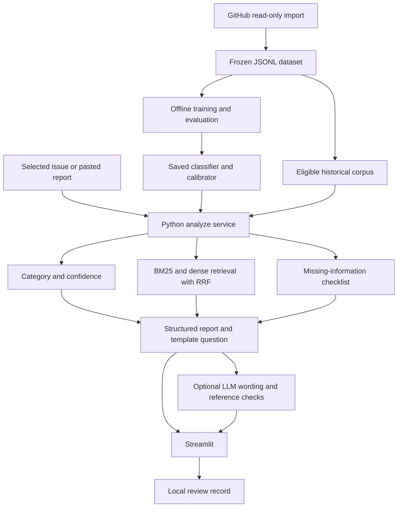

# Knotify — Final Five-Day Implementation Plan

**Updated:** 19 November 2026. **Deadline:** five working days from implementation start; Day 1–Day 5 below replace all earlier dated schedules. **Status:** implementation specification, not a claim of completed work.

This file is the authoritative build specification for Claude Code, Codex and the project developer. It supersedes the longer research protocol previously in this file and conflicting instructions in `KNOTIFY_BUILD_GUIDE.md` and `Knotify_Project_Context.md`. The submitted proposal PDF remains unchanged. This plan makes practical implementation choices within its central objectives. Work is ordered by dependencies and completion gates, with no assignments to people or required division between coding assistants.

## 1. What we are building

A local GitHub issue-triage application that:

1. Predicts `bug`, `feature`, `question_documentation`, or `other`.
2. Shows calibrated category confidence and a low-confidence human-review flag.
3. Retrieves up to five earlier related issues using BM25 and sentence embeddings.
4. Checks for missing debugging information.
5. Generates a traceable follow-up question, with optional LLM wording.
6. Displays results and saves local maintainer feedback in Streamlit.

**The proposal's architecture is sound.** The goal is to implement and compare established ML methods in a working system, not to invent a new algorithm or reproduce a production deployment historically. Simpler evaluation is appropriate provided the actual methods, sample sizes, limitations and omitted experiments are reported accurately. Institutional assessment requirements still apply; this plan does not claim faculty approval for deviations.

### Five decisions that must remain in the implementation

- Compare TF-IDF and embedding classifiers. Do not assume embeddings win; TF-IDF classification plus hybrid retrieval is a valid final system.
- Confidence belongs to the category prediction only. Retrieval scores and generated text do not inherit it.
- Explain TF-IDF predictions with SHAP or signed linear contributions. Do not call embedding-coordinate attributions word explanations.
- Validate citation IDs and checklist references, but do not equate a valid citation with a factually supported claim. Manually inspect a small sample.
- Deliver a local Streamlit application first. No React/FastAPI/PostgreSQL deployment, clustering, trends, fine-tuning, automatic GitHub writes or user-account system within these five days.

## 2. Scope and priorities

| Priority | Deliverable |
|---|---|
| Must finish | Frozen issue dataset, audited label mapping, TF-IDF and embedding LR comparison, BM25/dense/hybrid comparison, checklist, calibrated category prediction and deferral, evidence-linked template questions, working Streamlit demo, saved metrics and limitations |
| Small proposal-aligned experiments | One repository-transfer check; LLM-only comparison on a fixed small sample; TF-IDF SHAP demonstration; simple bootstrap intervals if time permits |
| Optional product polish | LLM-written question, simple category chart, extra UI styling |
| Explicitly deferred | Full web stack, background workers, continuous synchronization, historical revision reconstruction, complex annotation studies, clustering/trends, DistilBERT, deployment |

The small experiments are scheduled, not silently dropped. If access, data or time prevents one, mark it **not completed**, explain why, and do not describe the submission as satisfying that proposal item. The functioning core takes precedence over cosmetic polish.

## 3. Architecture and implementation contracts



These are ordinary Python modules, not separate services. Classification, retrieval and checklist run independently: a failed component must not remove the other results. No LLM is needed for the base report.

### Stack and folder layout

Use Python, scikit-learn, sentence-transformers, rank-bm25, CPU FAISS, pandas, Streamlit and pytest. Add SHAP for a small explanation demo. Use one team-compatible Python version and pin packages after testing imports on Windows. Native FAISS installation must not block the project: use exact NumPy cosine search temporarily, record the actual backend, and avoid claiming FAISS was used if it was not.

```text
src/knotify/
  contracts.py       # issue/report records shared by all modules
  ingest.py          # GitHub import and frozen export
  data.py            # cleaning, mappings and splits
  classifier.py      # TF-IDF and embedding LR, calibration
  retrieval.py       # eligible corpus, BM25, dense, RRF
  checklist.py       # applicability and completeness checks
  triage.py          # evidence registry, question templates, analyze()
  llm.py             # optional provider and structured response validation
  evaluate.py        # metrics, comparisons and saved predictions
ui/app.py
scripts/             # import, train, evaluate; thin wrappers
configs/             # repository mapping and fixed settings
tests/               # meaningful data, metric and integration checks
data/                # frozen JSONL, splits and annotations; gitignored
artifacts/           # models, embeddings and ID mapping; gitignored
runs/                # saved predictions, reports, analyses and reviews
README.md
```

Do not build a database abstraction layer. Frozen JSONL plus per-analysis JSON and local review JSON files are sufficient for a single-user demo. SQLite is optional if the team already knows it.

Define this shared service on Day 1:

```text
analyze(issue, repository_history, model_bundle, config) -> AnalysisReport
```

`Issue` fields: stable GitHub ID, repository full name, issue number, title, body, created/updated/fetched timestamps, source URL, source labels and mapped target. Only title/body enter the classifier.

`AnalysisReport` fields:

- Analysis ID, issue ID or pasted-input ID, dataset version, input hash and model version.
- Classification: predicted label, raw/calibrated probabilities when available, deferred flag, reason, calibration source repository.
- Related candidates: issue ID, real stored URL, rank, method scores and `relationship=related_candidate`.
- Checklist: item ID, status, reason and matched text when present.
- Question: text, checklist evidence IDs, reference-valid flag, template/LLM source.
- Optional summary: explicitly marked generated draft, never a verified conclusion.
- Component errors/warnings and elapsed time.

Unavailable probabilities are null, not zero. Persist a report before recording feedback; reviews reference its ID and do not overwrite original predictions or automatically retrain models.

## 4. Data: finish the feasibility check on Day 1

### Repository selection

Use two public repositories initially. Choose A with enough labelled examples for training and B for a small transfer test. Target the proposal's 2,000–4,000 usable labelled issues overall, but report the actual count if smaller. Do not spend days searching for a perfect dataset.

Inspect labels, class counts, time coverage and explicit duplicate links early. Aim for usable examples of all four categories in A. A `duplicate` label alone does not identify a matching issue. `needs-triage` does not mean `other`.

Write one repository-specific label mapping. Include examples with one unambiguous mapped category; exclude unlabelled and conflicting examples from supervised training, counting exclusions. Retain unlabelled issues in the retrieval corpus. Keep `other` for an actual audited semantic mapping, not a catch-all for uncertainty. Inspect about 40 mapped examples across classes/repositories. Coding assistants can prepare suggested annotations and a compact review sheet; record which judgements were human-reviewed and which remain model-generated. Do not describe model-generated annotations as independent human ground truth. This is a modest label audit, not a formal annotator-reliability study.

If all four classes are not feasible, try a replacement repository by the end of Day 1. Do not fabricate `other` examples or hide absent classes. A remaining taxonomy/data shortfall must be reported as a deviation from the proposal.

### Import and freeze

Fetch all issue states, follow pagination, exclude PR objects, retry transient failures with bounded backoff, and deduplicate by stable issue ID. Keep GitHub tokens outside source control and browser-visible content. Preserve raw title/body and timestamps. Save one dated JSONL snapshot, a content hash, mapping file and split IDs. Do not overwrite this snapshot during evaluation. A partial import is labelled partial and must not silently become the final dataset.

Full synchronization, edit-history tables and incremental watermark recovery are unnecessary. Run import offline before the demo. The GitHub endpoint includes pull requests and its `since` parameter refers to updates; see the [GitHub API documentation](https://docs.github.com/en/rest/issues/issues).

**Temporal limitation to state in the report:** current API snapshots can contain edits or labels added after creation. We split by creation date and retrieve earlier-created issues, but do not reconstruct the original historical text. This is a retrospective evaluation, not a verified historical replay. No implementation of a second replay mode is required.

Inputs exclude labels, author identity, close status and comments. Remove explicit duplicate-target URLs/markers from retrieval evaluation queries so the answer is not handed to the retriever; save the cleaned query and original for inspection. Remove exact normalized duplicate texts from the classifier dataset, keeping the earliest. Do not build a near-duplicate family discovery system; mention residual near-duplicates as a limitation. Keep historical duplicates available for retrieval because retrieving them is the task.

## 5. Classification and confidence: simple, defensible evaluation

### Splits and model selection

For repository A, sort by creation time and freeze approximately **60% Train / 20% Validation / 20% Test**. Keep equal timestamps together and record boundaries and per-class counts before modelling. Never use Test to tune settings, prompts or thresholds.

Start with fixed settings: TF-IDF word unigrams/bigrams, logistic regression `C=1`, `class_weight=balanced`, adequate iterations and a fixed seed. Preserve useful technical tokens and inspect the tokenizer on example error messages. Add a majority-class sanity baseline.

Compare frozen `sentence-transformers/all-MiniLM-L6-v2` embeddings plus logistic regression with the same classifier settings. Record the encoder revision. Encode title plus body deterministically, record its maximum length and truncation frequency, and use the same transformation at inference. One embedding per issue is enough; no chunking experiments in this deadline. Encoder truncation is described in the [Sentence Transformers documentation](https://www.sbert.net/docs/package_reference/sentence_transformer/model.html).

If settings genuinely need tuning, use only an earlier/later split **inside Train**, then refit on all Train before calibration. Do not create a large grid or more full-dataset partitions. Fit TF-IDF vocabulary/IDF only on Train. Choose the serving classifier by raw macro-F1 on the threshold-selection validation portion below; if the difference is under 0.01, prefer the simpler/faster TF-IDF model. This is a practical tie rule, not a significance claim. Save both models' Test results.

### Calibration and threshold

When feasible, divide Validation chronologically into two equal portions:

- **V-cal:** fit sigmoid calibration for the frozen candidate classifier(s).
- **V-policy:** compare candidates and select the threshold for the chosen classifier.

As a practical feasibility check, seek at least 100 examples in each portion and at least ten examples per class in V-cal. These counts are operational heuristics, not statistical guarantees. If the validation sample cannot support this, **use the whole Validation set for both calibration and threshold selection**, explicitly report this reuse and its potential optimism, and evaluate the frozen decisions on untouched Test. This acceptable pilot fallback replaces the earlier five-part research protocol. Model fitting and calibration data must still be disjoint, and Test must remain untouched. If calibration lacks a class entirely, fix the data selection or report calibration unavailable; do not manufacture probabilities.

Use the installed scikit-learn version's supported frozen-estimator calibration interface; avoid automatic random CV. See [scikit-learn calibration](https://scikit-learn.org/stable/modules/calibration.html). Do not refit the classifier after calibration without recalibrating it.

Try thresholds `{0.50, 0.60, 0.70, 0.80, 0.90, 0.95}`. Choose the one with greatest validation coverage and at least 90% accuracy among accepted predictions, with at least 20 accepted examples. These are chosen demo policy settings, not promised reliability. If none qualifies, defer all; still show the candidate category. Freeze the threshold before Test.

Report full-set macro/per-class F1, confusion matrix, raw/calibrated log loss and a five-bin reliability plot with counts. Report accuracy and F1 versus coverage, plus coverage and accuracy at the selected threshold:

```text
coverage = accepted / all examples
accepted accuracy = correct accepted / accepted
```

At zero acceptance, accepted accuracy/F1 is undefined. Always show sample counts and use the fixed four-class label list for macro-F1, explaining absent-class handling. Test curves illustrate behaviour; do not select a new production threshold from them. Coverage-at-fixed-F1, if reported, uses a validation-selected target/threshold and reports the actual Test outcome; otherwise explicitly omit that secondary proposal measure.

Confidence applies only to category prediction. Mark new-repository predictions as calibrated on A, with reliability on the new repository unverified. Keep all recommendations subject to human review; no automatic actions.

### Explanations

Implement TF-IDF SHAP on a few examples, explaining the chosen class's raw score with a training-derived background. If SHAP integration stalls, use signed feature contributions and call them exactly that; record SHAP as incomplete. Do not pretend these explain calibrated probabilities or a different embedding classifier. When embeddings are selected, show the TF-IDF explanation only in a clearly labelled baseline comparison panel. Token-level embedding SHAP is out of scope.

## 6. Retrieval: correct filtering, small evaluation

For an imported issue, eligible candidates are from the same repository, have `created_at < query.created_at`, and exclude self. For a freshly pasted report, use the current analysis time as cutoff and clearly label that mode. Equal creation timestamps are excluded in the benchmark.

Build BM25 on the eligible corpus, including its document-frequency statistics. Reuse precomputed embeddings but select eligible rows **before** dense ranking. Normalized embeddings with exact FAISS `IndexFlatIP` are sufficient; normalize the query too. Keep a stable row-to-issue-ID mapping. See [FAISS cosine similarity guidance](https://github.com/facebookresearch/faiss/wiki/MetricType-and-distances). A small global top-k followed by discarding future issues is not sufficient.

Retrieve up to 50 candidates from each method. Fuse with reciprocal rank fusion `sum(1/(60+rank))`, one-based ranks, zero contribution for absent candidates, deterministic issue-ID tie breaks. Display at most five. Do not tune RRF or add a reranker. Empty history returns no results. Call all results related candidates; similarity is not duplicate proof or a probability.

### Manual relevance sample

Target **30–50 held-out queries** with known earlier duplicate/related targets; attempt more only if readily available. This is smaller than the proposal's approximately 100 cases and must be disclosed. Use explicit duplicate links where available and inspect the pair. For each query, pool top-five results from BM25, dense and hybrid plus the known target, deduplicate, and judge `duplicate`, `related`, `irrelevant` or `uncertain`. Generate a review sheet with source links and annotation provenance; human spot-checking roughly ten queries is useful, but does not require a second person or a separate workstream. Keep duplicate and broader-related relevance distinct. Use five separate development examples to debug; freeze test sample selection before inspecting method performance.

For queries with known eligible relevant set R:

```text
Recall@5 = count(top5 intersect R) / count(R)
Hit@5 = 1 when any relevant item occurs in top5, otherwise 0
MRR@5 = mean(1 / first relevant rank in top5), or 0 on a miss
```

This plan uses **MRR@5**, because the judged pool covers all methods' top five; do not claim unbounded MRR. Recall is against known/judged positives, not an exhaustive set. No-known-positive queries have undefined recall and are listed separately with example results. This is enough for a modest comparison, not a comprehensive retrieval benchmark.

## 7. Checklist, evidence and LLM

### Deterministic checklist

Check reproduction steps, expected behaviour, actual behaviour, environment, version and logs. Use lightweight patterns and explicit applicability rules; an empty heading or untouched template is not sufficient. Return `present`, `missing`, `uncertain`, or `not_applicable`, with reason/matched text. Logs are conditional rather than mandatory for every bug. For a deferred category, phrase advice conditionally: “If this is a bug report…”.

Use about ten training/validation examples to develop rules and **30–40 separate manually checked bug reports** for final evaluation. Reuse suitable retrieval evaluation issues to reduce effort, without using their annotations to tune rules. Evaluate missing as the positive class on applicable items, with per-item and overall precision/recall/F1. Predicted uncertain on a truly missing item is a missed detection; report uncertainty rate. Exclude gold uncertain/not-applicable items from binary scoring and report their counts. Evaluate component results on manually identified bugs and demonstrate end-to-end behaviour on ordinary predicted categories.

### Evidence-linked questions

Default to fixed templates from missing applicable checklist items. Store evidence IDs such as repository-qualified issue IDs and `checklist:environment`; URLs come from imported records, never generated text. Validate that cited issues are in the eligible retrieved set and that referenced checklist items actually have the required status.

Use `reference_valid=true/false` and `semantic_support=not_checked` for free-form LLM text. A real reference does not verify its meaning. A template can be mechanically linked to a rule result, but the rule itself can still be wrong.

Manually inspect suggestions on **20 final examples**, checking whether the cited content supports them and whether requests are appropriate. Report invalid-reference count, manually unsupported suggestion count, number of suggestions retained, and empty-output count. One request for OS and another for version count as two suggestions. Zero suggestions does not imply perfect reliability. No automated entailment model, complex span annotation system or formal agreement study is required.

### Small LLM comparison

By Day 1, establish whether a provider/key is available. On **20–30 fixed held-out examples**, ask an LLM for category, missing items and follow-up questions from title/body only. Compare against the same examples from the classical and proposed pipelines. Give it the same taxonomy/checklist rubric but no model predictions or retrieved history. Retrieval metrics are not applicable to this LLM-only baseline. Do not accept self-reported confidence as calibrated.

For optional product drafting, supply approved checklist items and real evidence IDs. Validate structured output; on timeout, malformed JSON or invalid references, return the template question. Cache provider/model/prompt/settings/responses for evaluation, and set a small call budget. Issue text is data, not instructions; no tool execution or arbitrary URL access. Secrets stay in local environment variables.

A lightweight grounding ablation applies reference validation on/off to the **same cached drafts** and reports rejected suggestions and the manual checks above. Do not generate two different batches and attribute their differences solely to validation. Additional same-evidence prompt comparisons are unnecessary in five days.

## 8. Minimum results and honest reporting

Save one results table containing:

| Comparison | Required measurements |
|---|---|
| TF-IDF LR vs embedding LR | Macro-F1, per-class F1, confusion matrix, sample counts |
| Raw vs calibrated selected model | Log loss and reliability plot; accuracy/F1 versus coverage |
| BM25 vs dense vs hybrid | Recall@5, Hit@5, MRR@5 on identical queries |
| Checklist vs small LLM-only sample | Missing-item precision/recall/F1 on shared examples |
| Classical vs selected pipeline | Same-example category/retrieval/checklist results, rather than one invented overall score |
| Evidence checks | Invalid references, manual unsupported suggestions, retained/empty output counts |
| Transfer | Frozen A model/calibrator/threshold on B: macro-F1, coverage, accepted accuracy and sample counts |
| Performance | Median warm analysis latency, with and without actual LLM calls if used; hardware and number of runs |

For transfer, use B issues created after A's final validation cutoff where available. B labels are used for scoring only, not tuning. State if B's class coverage is limited. This one check is a pilot transfer experiment, not proof of generalization to all repositories.

If time permits, add simple paired bootstrap intervals for classifier macro-F1 differences and retrieval scores (500 resamples, fixed seed, resample issues/queries together across methods). Otherwise list confidence intervals as not completed. No elaborate hierarchical bootstrap is required. Current snapshots, small manual samples, possible near-duplicates, validation reuse if used, and limited transfer coverage belong in the limitations section.

A negative result is valid: do not change Test settings until the preferred method wins. Rerun Test only for a documented bug fix, not tuning. Explainability, confidence and source links do not prove correctness or saved maintainer time.

## 9. Build order and five-day checkpoints

Build one integrated product in the order below. The day labels are time budgets, not assignments. A single coding assistant can execute the entire sequence; switching between Claude Code and Codex must not create separate implementations.

| Checkpoint | Implementation sequence | Completion gate |
|---|---|---|
| Day 1 — First working path | Inspect existing code; establish package/configuration and shared contracts; import and freeze a usable dataset; define mappings/splits; train TF-IDF; implement BM25; connect a minimal Streamlit issue page. Prepare metric fixtures/review sheets and check LLM access. | A real imported issue displays its category and earlier BM25 candidates. Dataset/class feasibility is known and the baseline can be rerun. |
| Day 2 — Complete core pipeline | Cache embeddings; implement dense retrieval and RRF; train embedding LR; implement checklist and template questions; assemble the structured report; connect all fields to the UI. | A real issue produces every core output without an LLM. Both classifier variants run and historical filtering passes tests. |
| Day 3 — Reliability and review | Fit calibration, select classifier/threshold on validation, add TF-IDF explanation and reference checks; persist reports/reviews; implement optional LLM fallback; finalize evaluation annotations and run the small LLM comparison. | Configurations and test samples are frozen. Confidence/deferral, evidence links and failure states work. No new optional features after this gate. |
| Day 4 — Evaluate the finished pipeline | Run classification, transfer, retrieval, checklist and grounding comparisons; save predictions/tables/plots; measure latency; fix verified bugs. Add bootstrap intervals only if time permits. | Results trace to frozen data/configurations. Failures, omissions and limitations are written down. The complete demo is rehearsed. |
| Day 5 — Package and verify | Check offline startup, model reload and cached data; reproduce commands in a clean environment; complete README, report/screenshots and demo examples; fix remaining delivery blockers. | The product launches reliably and the documentation describes what actually works. |

### Instructions for coding assistants

1. Read this file and inspect the repository before editing. Continue existing working code rather than rebuilding from scratch or introducing a second architecture.
2. Implement the earliest incomplete checkpoint. Within it, build dependencies first: contracts/data before model consumers, component outputs before UI rendering, frozen configuration before final evaluation.
3. Keep one shared `analyze()` pipeline for the UI and evaluation. Integrate each component as soon as it works; do not leave integration until the last day.
4. Run the relevant tests and a real-input smoke check before marking a checkpoint complete. Mock outputs may help UI development but must not remain in the delivered workflow or results.
5. Maintain a short `IMPLEMENTATION_STATUS.md` containing completed checkpoints, exact run commands, artifact paths, known failures and the next concrete step. Use it to hand off between Claude Code and Codex without repeating completed work.
6. Automate collection, formatting, evaluation and report generation. Where human judgement or unavailable credentials are needed, prepare the concrete review material and continue independent implementation; never invent annotations, access or measured results.
7. Do not add named owners, team workstreams, mandatory subagents or coordination infrastructure. This plan specifies what to build, in what order, and how to verify it.

### Time limits and recovery rules

- Repository selection: half of Day 1; revisit only for a genuine class/data failure.
- Native FAISS installation: roughly one hour before exact NumPy fallback.
- SHAP troubleshooting: roughly one hour before labelled linear contributions.
- LLM integration: roughly two hours; keep templates if blocked and report missing LLM evaluation honestly.
- No new features after Day 3. Day 4–5 are for evaluation, fixes and delivery.
- If behind, cut styling, charts, generated summaries, extra experiments and bootstrap intervals first. Do not cut correct splits, temporal candidate filtering, the measured baseline or the end-to-end demo.

## 10. Tests and completion checklist

Keep tests focused on errors that would break the demo or invalidate results:

- Import excludes PRs, handles pagination, and deduplicates.
- Targets/metadata never enter feature text; splits are chronological and frozen.
- Training and calibration are disjoint; Test is not read during selection.
- A future high-similarity candidate cannot hide the best eligible historical result; BM25 uses eligible documents only.
- Retrieval handles self matches, empty history, correct ID mapping and stable RRF ties.
- Metric fixture with two positives distinguishes Recall@5 from Hit@5; zero accepted predictions produces undefined accuracy.
- Empty template fields and inapplicable checklist items behave correctly.
- Unknown evidence IDs are rejected; LLM failure returns templates; classifier failure still allows retrieval.
- Saved models reload, reports persist, and the UI visibly distinguishes category confidence from search scores.

Final submission folder must include runnable source, pinned dependencies, `.env.example` without secrets, startup instructions, frozen-data access instructions, saved model/config versions, split IDs, evaluation predictions/results, a short limitations/deviations section, and demo examples. Store large datasets/artifacts outside Git if necessary, but provide a working local copy or documented access path for the team.

The README should explain how to import once, train, evaluate and launch `streamlit run ui/app.py`; training should not happen on every UI interaction. Cache models and embeddings, bind the demo locally, render untrusted Markdown safely, and never upload private repository data.

**Done means:** a fresh checkout with the documented data/artifacts can launch the application, analyze a real issue with all core outputs, expose real source links and uncertainty/failure states, save feedback, and reproduce the reported comparisons from the frozen data. It does not mean every optional feature or every original proposal experiment has been completed; any omissions must be named.

## 11. What changed from the previous final plan

Removed five full experimental partitions, mandatory historical replay, formal duplicate-family benchmarks, large annotation quotas, multiple LLM drafting controls, elaborate persistence/job architecture and the multi-week schedule. Retained simple chronological evaluation, disjoint model fitting/calibration, an untouched Test set, correct retrieval eligibility/metrics, the five architectural recommendations, and transparent limitations.

This is a practical five-day academic implementation plan. Do not reintroduce the discarded requirements from the older guide unless the core is complete and time remains.
