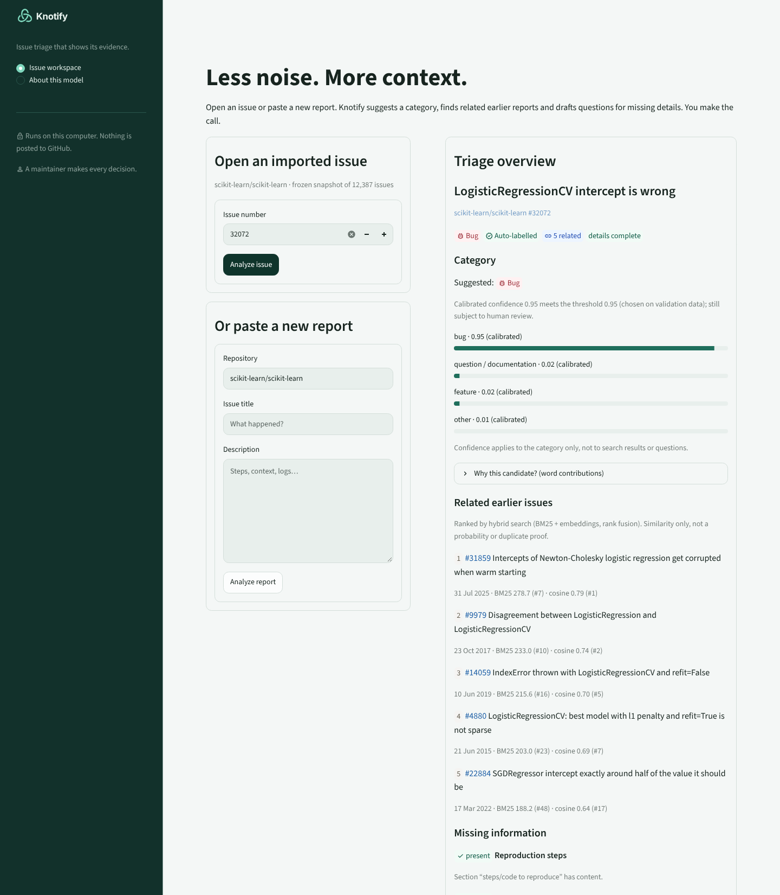

# Knotify

**A confidence-aware, evidence-linked triage assistant for GitHub issues.**
AIML mini-project, Department of CSE, Ramaiah Institute of Technology. Faculty guide: Prof. Uzma
Sulthana. Team: Anupam A Nair, Abhay G Warrier, Chinmay Panghri.

Given an issue, Knotify runs locally on a CPU with no LLM and posts nothing to GitHub:

1. **suggests a category**: `bug`, `feature`, `question_documentation` or `other`. It shows a calibrated
   confidence, and defers to a maintainer when confidence is below a threshold chosen on validation data.
2. **explains the suggestion** with SHAP word contributions for the TF-IDF model.
3. **finds up to five related earlier issues** with hybrid search: BM25 plus MiniLM embeddings,
   fused by reciprocal rank fusion (RRF). Only same-repository, earlier issues are searched.
4. **checks for missing debugging information** (reproduction, expected/actual behaviour,
   environment, version, error logs) and drafts follow-up questions that cite the checklist.
5. **records the maintainer's review** (accept / reject / edit) without altering the saved report.



More screenshots in [`docs/screenshots/`](docs/screenshots/).

## Results at a glance

Held-out, chronologically later issues; full tables in [`docs/results/results.md`](docs/results/results.md).

| What | Result |
|---|---|
| Category, scikit-learn Test (654 issues) | Macro-F1 **0.785** (TF-IDF, template text masked); embedding classifier 0.740; majority 0.088 |
| Confidence | Log loss 0.715 → **0.552** after calibration. At the frozen threshold, 4.7% of issues are auto-categorised at **96.8%** accuracy; the rest are deferred |
| Transfer to pandas (1,272 issues) | Macro-F1 0.724; no issue passes the scikit-learn-calibrated threshold |
| Related issues (47 explicit-duplicate queries) | Recall@5: BM25 0.362, embeddings 0.447, hybrid 0.447 (differences not statistically conclusive) |
| Missing-information checklist (21 human-confirmed bug reports) | Precision 0.833, recall 0.750, **F1 0.789** |
| Follow-up questions (56) | 0 without valid evidence; 3 asked for information already present |

Limitations and deviations from the proposal: [`docs/REPORT_NOTES.md`](docs/REPORT_NOTES.md).

## Quick start (Windows or macOS)

1. **Install uv.** Windows (PowerShell):
   `powershell -ExecutionPolicy ByPass -c "irm https://astral.sh/uv/install.ps1 | iex"`.
   macOS: `curl -LsSf https://astral.sh/uv/install.sh | sh`. Then open a **new** terminal.
2. **Get the code:** `git clone https://github.com/Anupam-hash926/Knotify.git` and `cd Knotify`.
3. **Copy the shared data:** put the team's `data/` and `artifacts/` folders into the repository
   root (about 150 MB; not in Git). Copy them rather than re-importing: GitHub content changes
   over time, and the results are tied to these exact files. `uv run knotify freeze
   scikit-learn/scikit-learn --verify` should print `intact`.
4. **Install and launch:**

   ```sh
   uv sync --locked --python 3.12 --extra ml --extra explain
   uv run streamlit run ui/app.py
   ```

   Open the printed `localhost` address and enter issue **32072**. See [`docs/DEMO.md`](docs/DEMO.md).

**Optional: full search for pasted text.** Imported issues already get hybrid search from the cached
embeddings. To also embed pasted reports, add `--extra embeddings` to `uv sync` and download the
model once (about 90 MB, gitignored):

```sh
uv run --no-project --with huggingface_hub python -c "from huggingface_hub import snapshot_download as d; d('sentence-transformers/all-MiniLM-L6-v2', local_dir='models/all-MiniLM-L6-v2', allow_patterns=['*.json','*.txt','model.safetensors','1_Pooling/*'])"
```

The app makes no network requests while running; the model loads in offline mode.

## Reproducing the pipeline

Each step is a `knotify` command. Steps that page through GitHub are read-only and resumable:
they exit with code 3 when paused, so run them again. A `GITHUB_TOKEN` in `.env` is optional.

| Stage | Command |
|---|---|
| Dataset audit | `uv run knotify audit` → `docs/audit/` |
| Frozen snapshots | `uv run knotify import scikit-learn/scikit-learn --start 2010-01-01 --end 2026-11-21` and `uv run knotify import pandas-dev/pandas --start 2024-09-11 --end 2026-11-21` |
| Chronological splits | `uv run knotify split scikit-learn/scikit-learn` |
| Classifiers | `uv run knotify train scikit-learn/scikit-learn` (TF-IDF) and `uv run knotify embed …` followed by `uv run knotify train … --model embedding` |
| Calibration, selection, threshold | `uv run knotify calibrate scikit-learn/scikit-learn` (validation only) |
| Explanations | `uv run knotify explain-setup scikit-learn/scikit-learn` |
| Evaluation samples / sheets | `uv run knotify duplicates …`, `uv run knotify review-sheets …`, `uv run knotify label-sheet …` |
| Freeze | `uv run knotify freeze scikit-learn/scikit-learn [--verify]` |
| Evaluation (reads Test) | `uv run knotify evaluate scikit-learn/scikit-learn`; latency: `uv run knotify latency … --label <machine>` |

Re-running `knotify evaluate` on the shared data reproduces `docs/results/` exactly; this was checked from
a fresh clone. Creating new snapshots, splits or freezes never overwrites existing ones.

## Checks

```sh
uv run ruff check . && uv run ruff format --check .
uv run pytest            # 49 tests; UI tests use an empty temporary workspace
uv run knotify doctor    # lists snapshots, models and optional packages; prints no secrets
```

GitHub Actions runs these on Linux, Windows and macOS.

## Project layout

```text
src/knotify/   contracts, config, GitHub client, audit, ingest, data/splits, features,
               classifier, embeddings, retrieval, checklist, drafting, triage (shared analyze()),
               selection (calibration/threshold), explain (SHAP), annotation, freeze,
               evaluation, storage, runtime, cli
ui/app.py      Streamlit interface (thin view over analyze())
configs/       default settings, audited repository mapping, audit candidates
docs/          audit evidence, freeze manifest, results, demo guide, report notes
data/ artifacts/ runs/ models/   local only (gitignored)
```

Project background and decisions: [`context.md`](context.md), [`KNOTIFY_FINAL_PLAN.md`](KNOTIFY_FINAL_PLAN.md).
Build log and exact artifact paths: [`IMPLEMENTATION_STATUS.md`](IMPLEMENTATION_STATUS.md). The submitted
proposal PDF is unchanged.
